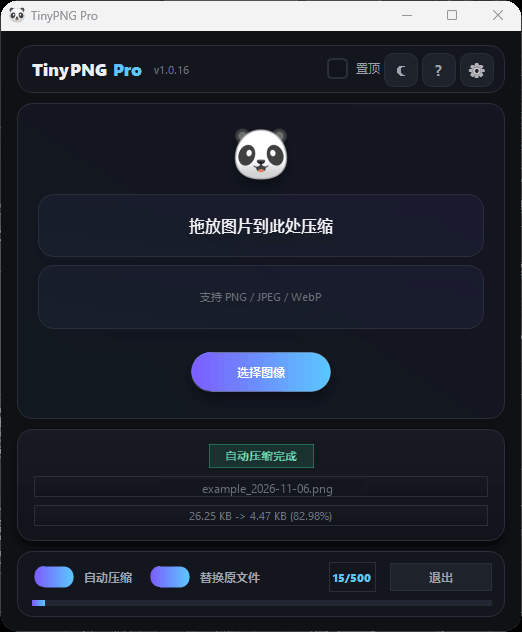
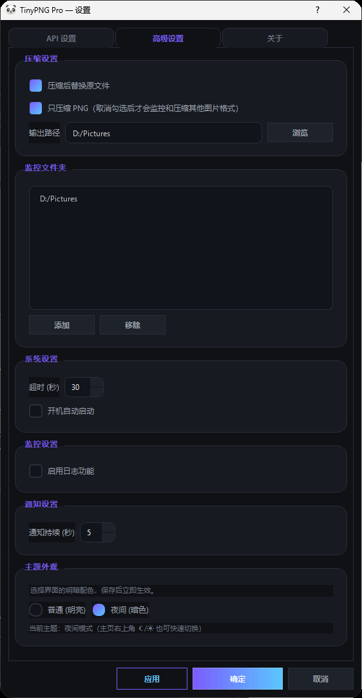

# TinyPNG Pro

常驻 Windows 系统托盘的图片压缩工具：拖入图片即刻压缩，或指定一个文件夹由它自动盯着——截图一落盘就压完，托盘弹一条结果通知。


## 目录

- [项目简介](#项目简介)
- [功能特性](#功能特性)
- [界面截图](#界面截图)
- [快速开始](#快速开始)
- [使用说明](#使用说明)
- [目录结构](#目录结构)
- [数据与隐私](#数据与隐私)
- [常见问题](#常见问题)
- [已知限制](#已知限制)
- [许可证](#许可证)

## 项目简介

截图、配图、聊天里保存的图片往往体积虚高，手动一张张丢进在线工具很麻烦。TinyPNG Pro 把这件事变成后台动作：你只管截图，它负责压缩、替换或另存，并在完成后告诉你省了多少。

压缩本身由 [TinyPNG](https://tinypng.com) 在线服务完成（`api.tinify.com`），本程序负责调度、监控与界面。

## 功能特性

| 能力 | 说明 |
|---|---|
| 拖放 / 多选压缩 | 拖入图片或点「选择图像」批量选择，任务进入后台队列，界面不阻塞 |
| 文件夹监控 | 基于 watchdog 的事件监听，监控目录中新出现的图片自动入队 |
| 覆盖或另存 | 可勾选「替换原文件」原地覆盖；否则生成 `原名_compressed.扩展名` |
| 只压缩 PNG | 默认开启，关闭后同时处理 JPG / JPEG / WebP |
| 多 API Key | 可保存 3 个 Key，设置页可切换当前使用哪一个 |
| 去重保护 | 已处理文件记录在本地账本，重启后仍不会重复压缩；自动生成的副本不会被再次监控 |
| 托盘常驻 | 关闭主窗口不退出，压缩结果通过托盘通知呈现 |
| 双主题 | 明亮 / 夜间，选择即时生效并自动保存 |
| 开机自启 | 可选，写入当前用户注册表 `Run` 项 |
| 日志查看 | 需在设置中打开「启用日志功能」，日志按日期拆分 |

## 界面截图

| 主界面 | 设置界面 |
|---|---|
|  |  |

主界面下方是最近一次压缩的结果卡片（文件名、压缩前后体积、节省比例），底部是自动压缩 / 替换原文件开关与本月额度条。

## 快速开始

**环境要求**：Windows 10 / 11，Python 3.9 及以上（开发与测试环境为 Python 3.14），一个 [TinyPNG API Key](https://tinypng.com/developers)。

```bash
# 安装依赖
pip install -r requirements.txt

# 从源码启动
python main.py
```

首次启动若没有配置文件，会在程序目录生成 `config.ini`，并弹出「API 密钥未配置」的提示，确认后直接进入设置页填写 Key。也可以稍后在「设置 → API 设置」中配置并点「验证」检查是否可用。

**打包为单文件 exe**

`requirements.txt` 只列运行期依赖，不包含打包工具本身。打包需额外安装 `pyinstaller` 与构建期依赖 `pillow`——后者只用于把 `icon.png` 转成 ICO 图标，运行时不依赖它：

```bash
# 构建期依赖（pillow 仅用于图标转换）
pip install pyinstaller pillow

# 按 spec 打包
pyinstaller TinyPNG_Pro.spec
```

漏装 `pillow` 时，PyInstaller 会中断并报 `Received icon image ... which exists but is not in the correct format`。

产物为 `dist/` 下的 `TinyPNG Pro.exe`，双击即可运行，目标机器无需安装 Python。`config.ini`、`processed_state.json` 与 `logs/` 会生成在 exe 同目录。

## 使用说明

- **手动压缩**：拖入图片或点击「选择图像」。任务进入后台线程处理，处理期间界面可正常操作；一批结束后只弹一条汇总通知。
- **自动压缩**：勾选主界面底部「自动压缩」，在「设置 → 高级设置 → 监控文件夹」里添加目录。只处理监控启动后**新出现**的文件，以及启动后被**重新保存（内容变化）**的文件；启动前已存在且未改动的图片不会被压。
- **输出位置**：设置中的「输出路径」为空时，结果写回原路径（配合「替换原文件」）；配置了目录则输出到该目录。
- **与手动压缩共存**：手动压缩过的文件会被登记到抑制表与账本，监控不会对同一文件再压一次。
- **托盘与退出**：关闭窗口只是隐藏，程序继续在托盘运行；托盘菜单可打开主界面、设置、日志查看器，或彻底退出。
- **单实例**：同一时间只允许一个进程，重复启动会唤回已有窗口，避免两个实例同时监控同一目录。

## 目录结构

```
.
├─ main.py               # 入口：组件装配、全局样式、托盘/窗口生命周期、单实例保护
├─ config_manager.py     # 配置读写（线程安全单例，读写 config.ini）
├─ compression_manager.py# 任务队列、工作线程、去重账本
├─ folder_watcher.py     # 目录监控与事件过滤、冷却去重
├─ tinypng_api.py        # TinyPNG 接口调用（Session 复用 + 有限重试）
├─ logging_system.py     # 日志单例（文件 + 控制台）
├─ startup_manager.py    # 开机自启（注册表 Run 项）
├─ utils.py              # 路径、大小格式化、文件类型判定
├─ version.py            # 版本号与更新日志
├─ ui_main_window.py     # 主窗口
├─ ui_settings.py        # 设置窗口
├─ ui_tray.py            # 托盘图标与通知
├─ ui_log_viewer.py      # 日志查看窗口
├─ ui_theme.py           # 明亮 / 夜间双主题样式
├─ icon.png              # 应用图标，同时作为打包图标
├─ requirements.txt      # 依赖清单
├─ TinyPNG_Pro.spec      # PyInstaller 打包配置
├─ LICENSE               # MIT 许可
└─ docs/screenshots/     # README 配图
```

运行时还会生成 `config.ini`（本机配置）、`processed_state.json`（去重账本）、`logs/`（日志），三者已在 `.gitignore` 中排除。

## 数据与隐私

- **联网范围**：仅与 `https://api.tinify.com` 通信，用于上传待压缩图片、下载压缩结果。没有第三方统计、埋点或自动更新请求。
- **会上传什么**：只有你选择或监控目录中被新写入的图片文件本身。TinyPNG 侧的处理与留存规则以其服务条款为准，敏感素材请自行评估。
- **Key 怎么存**：API Key 以明文写在程序目录的 `config.ini` 中，没有加密。切勿把该文件随仓库、压缩包或截图外发。
- **本地记录**：`processed_state.json` 保存文件绝对路径与 (修改时间, 大小) 用于去重，最多保留 30 天、5000 条；`logs/` 仅在开启日志功能时写入，内容可能包含本机文件路径。
- **不收集**：不读取与压缩无关的文件，不采集设备信息或使用数据。

## 常见问题

**每月能压多少张？**
TinyPNG 免费 Key 每月 500 张，主界面底部会显示本月已用数量，超额后接口会返回错误。程序不做额度拦截，也不自动换 Key——需要在设置里手动切换 `active_key` 到另一个已填写的 Key。

**为什么监控目录里已有的图片没被压缩？**
这是有意设计：监控启动时以启动时刻为水位，之前就存在且之后没被改写的文件视为旧文件跳过，避免一启动就把历史图片全部压一遍。想压旧图，直接拖进窗口手动处理。

**同一张图会不会被压两次？**
不会重复触发：手动压缩的结果会登记到抑制表和账本；自动压缩生成的 `_compressed` 副本会被监控直接忽略，不会形成无限嵌套。

**压缩失败会重试吗？**
对 429 / 5xx 与连接错误有有限重试（最多 2 次，指数退避），复用 HTTP 连接。重试仍失败会在通知里给出原因，如 `Invalid API key`、`API rate limit exceeded`、`Invalid image file`。

**换了电脑或重装后要做什么？**
程序自身无需安装，拷贝 exe 即可。开机自启项与配置不随 exe 迁移，需要在设置里重新勾选并填写 Key；`processed_state.json` 只影响去重记忆，删掉也不影响功能。

## 已知限制

- 仅支持 Windows：托盘、注册表自启、单实例互斥、窗口激活均使用 Windows API，未做跨平台适配。
- 只处理 PNG / JPG / JPEG / WebP，其它格式会被跳过并提示。
- 自动压缩依赖系统文件事件，个别网络盘、虚拟盘或特殊同步目录可能收不到事件，此时请改用手动压缩。
- 仅中英文界面文案固定，不含多语言切换。
- 主题切换会重建主窗口与设置窗口，窗口尺寸与位置不保留。

## 许可证

本项目采用 [MIT License](LICENSE)，Copyright (c) 2026 windmemo。

本项目为个人第三方工具，与 TinyPNG 官方无隶属关系；TinyPNG 为其权利人的商标与服务。
